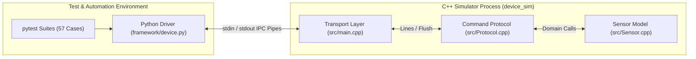

# Temperature Sensor Simulator

[](https://github.com/EdenEitan/Temperature-Sensor-Simulator/actions/workflows/tests.yml)

## Why I built this

I built this project to get hands-on experience with Software Test Development Engineering. I started by learning pytest, test automation frameworks and tools, testing methodologies, and test-case design. I wanted to go beyond the theory and apply what I had learned to a system I could understand, control, and test from end to end. As I learned more, I noticed how much testing had in common with my previous cyber research work: understanding how systems behave, questioning assumptions, and exploring what happens when something goes wrong or an input isn't what was expected.

## Architecture



For the development process, including my own sensor implementation, the integration work, and what I learned along the way, see the [development journal](docs/DEV_JOURNAL.md).

## What is implemented
    
- Controlled raw readings, calibration, inclusive alarm thresholds, reset, and successful-read counting.
- Separate sensor, command-protocol, and stdin/stdout transport layers.
- Sensor faults: disconnected, stuck, and timed-out readings; a separate communication failure silences every command.
- Python methods such as `set_temperature()`, `read()`, and `status()`, plus raw commands for negative testing.
- Response deadlines, rejection of driver reuse after timeout, and child-process cleanup.
- **57 pytest cases and 24 C++ unit cases**; CTest registers the C++ cases in two executables.
- GitHub Actions on Ubuntu with Python 3.11/3.12, plus a separate Clang ASan/UBSan job for the C++ unit suites.

Counts describe the current test inventory. The badge and [Actions runs](https://github.com/EdenEitan/Temperature-Sensor-Simulator/actions) show execution status.

## Design choices worth looking at

| Question | Decision and consequence |
| --- | --- |
| How can boundary tests be repeatable? | Set raw temperature explicitly; no random readings or real-time thermal model. |
| Where does a failure belong? | `Sensor` reports measurement status; `CommandProtocol` decides whether to return an error or suppress a reply. |
| How much should tests know about the wire format? | Typed methods express test intent; raw `command()` remains available to exercise invalid protocol input. |
| What happens after no response? | The driver requires a fresh process, because the protocol has no request IDs to correlate a late reply. Restart also loses sensor state. |
| How can tests avoid hiding a server-side validation bug? | Typed setters reject invalid types/non-finite values, but leave numeric range checks to C++; raw tests bypass typed validation. |

## Architecture

| Layer | Responsibility | Source |
| --- | --- | --- |
| Tests | Check domain rules directly and exercise the complete process boundary | [C++ suites](tests/cpp/), [pytest suites](tests/) |
| Python driver | Typed API, raw requests, deadlines, response parsing, process lifecycle | [device.py](framework/device.py) |
| Transport | Read stdin lines and flush replies to stdout | [main.cpp](src/main.cpp) |
| Protocol | Parse commands, dispatch operations, format replies, inject communication failure | [Protocol.cpp](src/Protocol.cpp) |
| Sensor | Own state, validate numeric inputs, calculate readings and alarms | [Sensor.cpp](src/Sensor.cpp) |

Each `Device` instance owns one simulator process. Commands are sequential; this version has no TCP server or shared multi-client sensor.

## Build and try it

Use **Linux or WSL**, a C++17 compiler, CMake 3.16+, and Python 3. The Python driver's selector-based pipe handling does not support native Windows.

From the repository root:

```bash
cmake -S . -B build -DCMAKE_BUILD_TYPE=Debug
cmake --build build
./build/device_sim
```

An interactive session (each command is followed by its response):

```text
PING
PONG
SET 77
OK
CALIBRATE 3
OK
READ
DATA 80.00 ALARM
STATUS
STATUS NONE 1
```

Press Ctrl+D to exit. For a Python smoke test:

```bash
python3 -m scripts.try_driver
```

Or use the typed API:

```python
from framework.device import Device

with Device("build/device_sim") as sensor:
    sensor.set_temperature(77)
    sensor.set_calibration(3)
    reading = sensor.read()
    print(reading.temperature, reading.alarm)  # 80.0 True
    print(sensor.status().samples)             # 1
```

## Run the tests

After the build above:

```bash
python3 -m venv .venv
source .venv/bin/activate
python3 -m pip install pytest
ctest --test-dir build --output-on-failure
python3 -m pytest -v
```

pytest builds the simulator once per session unless `DEVICE_BINARY` points to an existing executable. Each device fixture starts a fresh process. The [test plan](docs/TEST_PLAN.md) maps scenarios to actual tests and records coverage gaps.

CI runs CTest and pytest, saving pytest JUnit reports per Python version. Its separate sanitizer job runs **C++ unit tests only**, with a CTest JUnit report.

## Behavior at a glance

| Setting | Default | Accepted input |
| --- | --- | --- |
| Raw temperature | 25 °C | −40 to 125 °C |
| Calibration offset | 0 °C | −10 to 10 °C |
| Alarm threshold | 80 °C | −40 to 125 °C |

A reading is `raw + offset`; the alarm is active at `reading >= threshold`. The calibrated result is not clamped to the raw-input range: −50 °C and 135 °C are valid outputs at the combined extremes. Only successful reads increment the counter.

`STUCK` uses a fixed raw 25 °C, with calibration still applied. `DISCONNECTED` returns an explicit error. `TIMEOUT` suppresses `READ` replies. `COMMUNICATION_FAILURE` acknowledges activation, then suppresses all replies until restart.

See the [protocol reference](docs/PROTOCOL.md) for commands, errors, Python return types, and recovery rules.

## Development notes and next steps

- [Development journal](docs/DEV_JOURNAL.md) — developing the sensor and the C++/Python integration.
- [Test development journal](docs/TEST_DEVELOPMENT_JOURNAL.md) — the six-stage testing workflow.
- [Test execution and evaluation journal](docs/TEST_EVALUATION_JOURNAL.md) — discoveries during testing and the fixes that followed.
- [Research notes](docs/RESEARCH_NOTES.md) — what informed the initial scope.
- [Manual test log](docs/MANUAL_TEST_LOG.md) — recorded observations, including a stale executable.
- [Test plan](docs/TEST_PLAN.md) — test intent, coverage, and remaining gaps.
- [Next steps](docs/NEXT_STEPS.md) — deterministic thermal response and a shared-sensor Reactor server, with design details and proposed tests.

