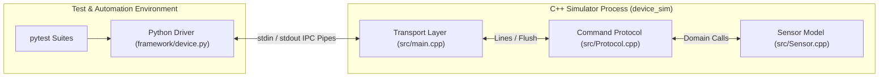

# Temperature Sensor Simulator

[](https://github.com/EdenEitan/Temperature-Sensor-Simulator/actions/workflows/tests.yml)

## Why I built this

I built this project to get hands-on experience with Software Test Development Engineering. I started by learning pytest, test automation frameworks and tools, testing methodologies, and test-case design. I wanted to go beyond the theory and apply what I had learned to a system I could understand, control, and test from end to end. As I learned more, I noticed how much testing had in common with my previous cyber research work: understanding how systems behave, questioning assumptions, and exploring what happens when something goes wrong or an input isn't what was expected.

## Architecture



| Layer | Component | Responsibility |
| --- | --- | --- |
| **Test Suites** | `tests/`, `tests/cpp/` | Unit-level domain assertions and end-to-end integration scenarios. |
| **Driver / Client** | `framework/device.py` | Subprocess lifecycle, typed API, wire framing, deadlines, and deserialization. |
| **Transport** | `src/main.cpp` | Line-buffered stdin ingestion and explicit stdout flushing. |
| **Command Protocol** | `src/Protocol.cpp` | Wire parsing, token validation, response formatting, and communication fault injection. |
| **Domain Core** | `src/Sensor.cpp` | State ownership, finite-number range checks, calibration offsets, and inclusive alarm rules. |

For the development process, including my own sensor implementation, the integration work, and what I learned along the way, see the [development journal](docs/DEV_JOURNAL.md).

## Engineering Highlights

* **IEEE-754 Floating-Point Robustness:** Setter boundaries explicitly enforce `std::isfinite` (and `math.isfinite` in the driver) alongside numeric range checks. Standard interval checks (`value < min || value > max`) fail silently on `NaN` because all relational comparisons with `NaN` evaluate to `false`.
* **Protocol Desynchronization Protection:** In a serialized protocol without request IDs, a delayed response cannot be correlated safely with subsequent commands. The Python driver immediately marks the communication stream invalid upon timeout and mandates a process restart to prevent silent state corruption.
* **Clean Layered Architecture (SRP):** Complete separation between standard I/O transport (`main.cpp`), command parsing/dispatch (`CommandProtocol.cpp`), and core simulation logic (`Sensor.cpp`).
* **Dual Testing Pyramid:** 24 standalone C++ unit tests isolate domain and protocol logic, while 57 pytest integration tests exercise real subprocess IPC boundaries, timeouts, and process failures.
* **Memory & Runtime Safety in CI:** GitHub Actions runs automated matrix tests across Python 3.11 and 3.12, supplemented by a dedicated Clang job instrumented with AddressSanitizer (ASan) and UndefinedBehaviorSanitizer (UBSan).
* **Empirical Test Verification (Mutation Testing):** The test suite's sensitivity was validated by deliberately injecting logic and boundary bugs (such as altering `>=` to `>` on threshold comparisons and bypassing calibration offsets) to ensure assertions catch realistic off-by-one errors.
---

## Design Choices & Trade-offs

| Question | Decision | Engineering Rationale |
| --- | --- | --- |
| **Boundary determinism** | Explicit `SET` raw temperatures | Eliminates non-deterministic race conditions and real-time sleeps in CI; models exact float boundaries (e.g., 79.99 vs 80.00 °C). |
| **Failure ownership** | Separated sensor vs protocol faults | Sensor reports physical status (`DISCONNECTED`, `STUCK`, `TIMEOUT`); protocol layer decides whether to return error payloads or suppress replies (`COMMUNICATION_FAILURE`). |
| **Wire abstraction** | Dual typed / raw test interface | High-level typed methods (`read()`, `status()`) express test intent; raw `command()` escape hatch remains available to inject malformed framing and test parser resilience. |
| **Timeout handling** | Strict stream invalidation | Prevents late responses from bleeding into the next command's response window on unindexed sequential streams. |
| **Validation placement** | Client type-guards, server range-guards | Python driver rejects local non-numeric/non-finite types; numeric domain ranges (-40 to 125 °C) are validated exclusively by C++ to prevent tests from masking server validation bugs. |

---

## Behavior & Protocol Reference

The simulator communicates over standard I/O using a single-line ASCII command/response format.

| Setting | Default | Input Range | Wire Output Rule |
| --- | --- | --- | --- |
| **Raw Temperature** | 25.0 °C | −40.0 to 125.0 °C | Formatted to 2 decimal places (`DATA <temp> <ALARM\|NORMAL>`). |
| **Calibration Offset** | 0.0 °C | −10.0 to 10.0 °C | Additive: `calibrated = raw + offset`. |
| **Alarm Threshold** | 80.0 °C | −40.0 to 125.0 °C | Inclusive: triggers when `calibrated >= threshold`. |
| **Sample Counter** | 0 | Monotonic counter | Increments **only** on successful reads; errors leave counter unchanged. |

*Output range is unconstrained:* Calibrated readings are not clamped to the raw input bounds; `-40 + (-10) = -50 °C` and `125 + 10 = 135 °C` are legitimate outputs at extreme boundaries.

### Fault Injections

* `FAULT STUCK`: Reports a frozen raw 25.0 °C (calibration still applies; read succeeds).
* `FAULT DISCONNECTED`: `READ` commands return `ERR DISCONNECTED`.
* `FAULT TIMEOUT`: Sensor suppresses responses to `READ` commands only.
* `FAULT COMMUNICATION_FAILURE`: Returns `OK` once, then silences all subsequent commands until process termination.

---

## Build and Run

### Prerequisites

* Linux or WSL (Windows Subsystem for Linux).  
  *(Note: The Python driver utilizes the POSIX `selectors` module on anonymous OS pipes. Native Windows `select()` only supports sockets).*
* C++17 compliant compiler (GCC 9+ or Clang 10+)
* CMake 3.16+
* Python 3.10+ and `pytest`

### Quickstart

```bash
# Clone repository
git clone https://github.com/EdenEitan/Temperature-Sensor-Simulator.git
cd Temperature-Sensor-Simulator

# Configure and compile
cmake -S . -B build -DCMAKE_BUILD_TYPE=Debug
cmake --build build

# Launch interactive CLI
./build/device_sim
```

Interactive session example:
```text
PING
PONG
SET 77
OK
CALIBRATE 3
OK
READ
DATA 80.00 ALARM
STATUS
STATUS NONE 1
```

### Python Driver Usage

```python
from framework.device import Device

with Device("build/device_sim") as sensor:
    sensor.set_temperature(77.0)
    sensor.set_calibration(3.0)
    
    reading = sensor.read()
    print(f"Temperature: {reading.temperature}°C, Alarm Active: {reading.alarm}")
    # Output: Temperature: 80.0°C, Alarm Active: True
    
    status = sensor.status()
    print(f"Fault State: {status.fault}, Processed Samples: {status.samples}")
    # Output: Fault State: NONE, Processed Samples: 1
```

---

## Testing & CI Pipeline

The project implements a complete testing strategy spanning unit, integration, and contract verification.

```bash
# Set up Python virtual environment
python3 -m venv .venv
source .venv/bin/activate
pip install pytest

# 1. Run C++ unit suites via CTest (sensor_unit & protocol_unit)
ctest --test-dir build --output-on-failure

# 2. Run Python integration test suite
pytest -v
```

### CI/CD Workflow (`.github/workflows/tests.yml`)

1. **Multi-Version Integration Matrix:** Builds binaries and executes both CTest and pytest suites against Python 3.11 and 3.12 on Ubuntu runners, generating structured JUnit XML test reports.
2. **Clang Sanitizer Pipeline:** A standalone CI job compiles the C++ codebase with `-fsanitize=address,undefined -fno-omit-frame-pointer` and runs the unit suites under CTest with leak detection (`detect_leaks=1`) enabled to guarantee memory integrity.

---

## Engineering Documentation

Detailed breakdowns of design phases, test strategies, and architectural extensions:

* [Development Journal](docs/DEV_JOURNAL.md) — Architecture evolution, ChatGPT integration review, and refactoring history.
* [Test Development Journal](docs/TEST_DEVELOPMENT_JOURNAL.md) — Six-stage test engineering workflow and design rationales.
* [Test Evaluation Journal](docs/TEST_EVALUATION_JOURNAL.md) — Deep dive into the `NaN` input flaw, bug reproduction, and mutation testing.
* [Test Plan](docs/TEST_PLAN.md) — Full verification matrix, test priorities (P0/P1), and coverage gaps.
* [Protocol Specification](docs/PROTOCOL.md) — Wire format, return types, and recovery specifications.
* [Manual Test Log](docs/MANUAL_TEST_LOG.md) — Integration transcripts and diagnosis of stale build artifacts.
* [Next Steps & Roadmap](docs/NEXT_STEPS.md) — Mathematical formulation for simulated thermal inertia and Java Reactor concurrent server design.
