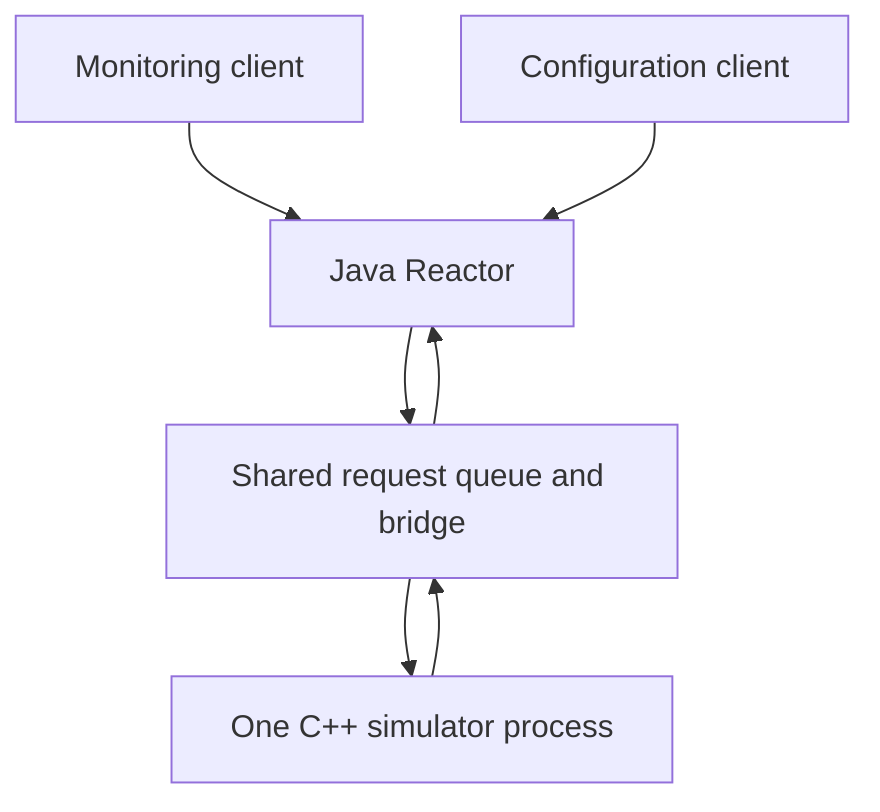

# Next steps and design notes

1. Shared sensor through a Reactor server
2. Deterministic thermal response


## Deterministic thermal response

### Motivation

Today, `SET` assigns the raw reading directly. That is useful for boundary tests, but it does not model a sensor gradually responding to its surroundings. I want to explore an optional environment temperature and explicit simulated time.

### Proposed state and interface

```cpp
// Proposed declarations — not present in the current Sensor.h.
double environmentTemperature = 25.0;
static constexpr double kThermalTimeConstantSeconds = 5.0;

bool setEnvironmentTemperature(double value);
bool advanceTime(double dt);
```

The existing `temperature` would remain the current raw sensor reading. Five seconds would be a chosen simulation parameter, not a measured hardware specification.

For a constant environment over one step, the proposed update is:

```text
alpha = 1 - exp(-dt / time_constant)
temperature += alpha * (environmentTemperature - temperature)
```

If the sensor starts at 25 °C and the environment changes to 90 °C, advancing simulated time would move the reading toward 90 rather than jumping immediately. `READ` would still apply calibration and evaluate the alarm.

### Compatibility and open decisions

Keep direct `SET` available. Thermal evolution should occur only when `advanceTime()` is called, preserving existing deterministic tests and avoiding real-time sleeps. Protocol commands for the environment and time step would be a separate addition.

Before implementation, define accepted environment limits, how zero/negative/non-finite time steps are handled, reset behavior, and the interaction between thermal updates and `STUCK`. A frozen reported reading and a frozen internal thermal state are different choices.

### Proposed tests

- Zero elapsed time leaves state unchanged; valid positive time moves toward the environment without overshooting.
- Repeated steps approach the target and are reproducible.
- Invalid inputs leave valid state intact.
- Calibration and alarm transitions use the evolved raw reading.
- Direct `SET`, reset, and existing fault tests retain their documented behavior.
- Equivalent elapsed-time partitions agree within a defined floating-point tolerance.

Noise, quantization, and drift could follow later, with deterministic seeds where randomness is introduced.

## Shared sensor through a Reactor server

### Motivation

A monitoring client and a configuration client may need access to the same sensor. I want to explore concurrent clients without creating a different sensor for each connection.

The proposed starting point is the Java Reactor framework from my SPL course: `Reactor`, `ActorThreadPool`, `NonBlockingConnectionHandler`, and `LineMessageEncoderDecoder`. Reused course components would be attributed as such, with their reuse terms checked before inclusion.

### Proposed architecture



The Java server would accept TCP connections and decode line-based commands. A bridge, potentially using `ProcessBuilder`, would forward requests through the existing C++ stdin/stdout protocol. Request ownership would be retained so each reply returns to the correct client.

The existing command-line entry point would remain independently usable. This extension would add a server around it rather than introduce concurrency inside the sensor core.

### The synchronization problem

The course `ActorThreadPool` uses the connection handler as the actor key. Ordering tasks within one connection does not serialize requests from different clients accessing the shared sensor.

The bridge therefore needs one global in-flight transaction to the C++ process, a queue for competing requests, and response routing. Blocking pipe operations must not run on the Reactor selector thread. Thread-safety and shutdown behavior of the reused components need review before relying on them.

### Failure handling to decide

A `TIMEOUT` deliberately produces no C++ reply. The bridge must enforce a deadline and stop reusing a stream whose request/response alignment is uncertain. Restarting the process would reset shared state for every client.

The server design still needs explicit rules for queued requests during recovery, requests belonging to disconnected clients, queue limits/backpressure, and reporting loss of configuration after restart. Those policies should be agreed before implementation rather than hidden in exception handlers.

### Proposed tests

- Two clients observe one shared sensor state.
- Competing reads maintain the correct successful-read count.
- Replies are routed to the requesting client.
- Concurrent `SET`, `READ`, and `RESET` obey the chosen serialization order.
- Slow or disconnected clients do not block unrelated connections.
- A timeout or process crash produces defined outcomes for in-flight and queued requests.
- Restart and shutdown release all sockets, workers, pipes, and the child process.

## Strengthen the existing test boundary

Before extending the system, useful follow-up work includes deliberately malformed/partial/late device replies, missing-executable behavior, parser fuzzing, and branch-coverage measurement. The [test plan](TEST_PLAN.md) records the current gaps; these are not counted as completed tests.
